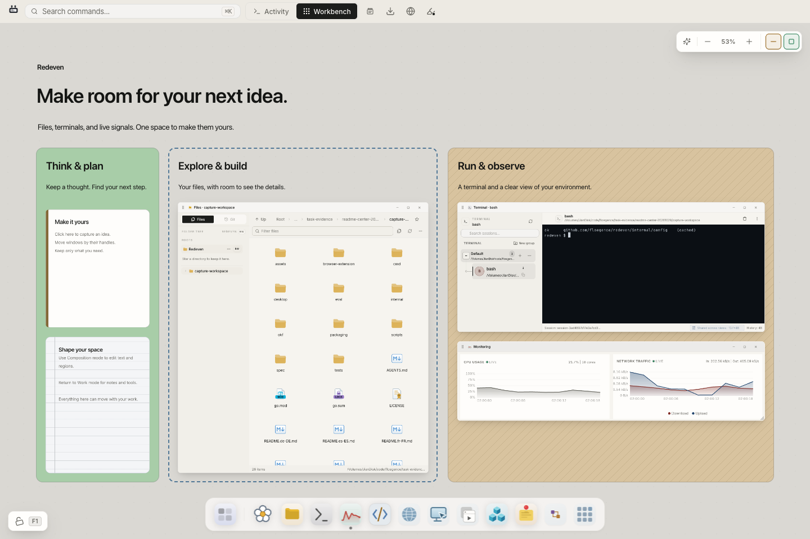
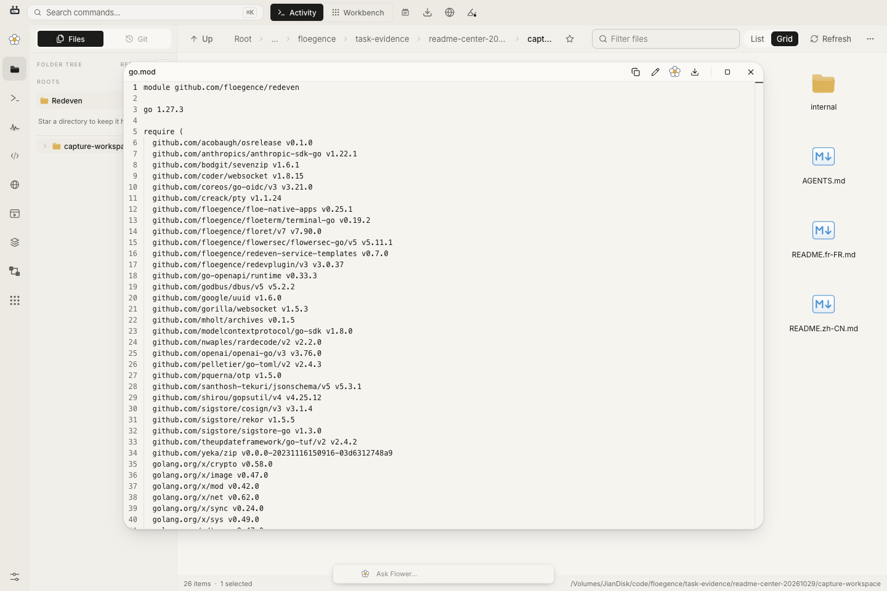
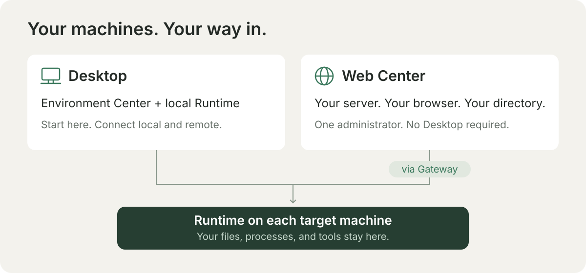

<p align="center">
  
</p>

# Redeven

**Where machines become workspaces.**

Ваши компьютеры и серверы: файлы, терминалы, Git и ИИ в одном месте. Работайте в браузере. Проекты остаются на ваших машинах.

**[Официальный сайт](https://redeven.com)** · **[Попробовать демо](https://redeven.com/#product)** · [Скачать Desktop](https://redeven.com/download) · [Документация](https://redeven.com/docs)



<!-- readme-section:work -->
<a id="work"></a>

## Всё для вашей следующей идеи

- **Пространство для вашей работы.** Размещайте файлы, терминалы, заметки и мониторинг на Workbench.
- **От идеи к работающему коду.** Просматривайте изменения, открывайте редактор и запускайте веб-сервисы на той же машине.
- **Работайте вместе с Flower.** ИИ-помощник, который использует инструменты вашей среды с вашего разрешения.



Снимки сделаны в работающем Redeven в Chrome: показаны исходные файлы проекта и реальный сеанс терминала.

<!-- readme-section:start -->
<a id="start"></a>

## Выберите свой способ начать



- **[Desktop](https://redeven.com/docs/download-desktop)** — самый простой старт на macOS и Linux: встроенная локальная среда выполнения и пошаговая настройка удалённых подключений.
- **[Среда выполнения](https://redeven.com/docs/download-runtime)** — запустите непосредственно на компьютере или сервере и откройте рабочее пространство в браузере.
- **[Web Center](https://redeven.com/docs/environment-center)** — разверните частный каталог окружений для одного администратора. Открывайте разрешённые среды выполнения в браузере без Desktop. Доступность пакетов и настройка описаны в руководстве.

Нужен совместный доступ через учётные записи? Узнайте о [Redeven Cloud](https://redeven.com/docs/control-plane-providers).

Файлы и процессы остаются на целевой машине. Flowersec защищает удалённые сеансы; Web Center — доверенный прокси, которому виден трафик приложений. [Подробнее о модели безопасности](https://redeven.com/docs/security-architecture).

<!-- readme-section:documentation -->
<a id="documentation"></a>

## Узнайте больше

[Начало работы](https://redeven.com/docs/getting-started) · [Руководство по развёртыванию](okf/operations/web-center-deployment.md) · [Выпуски](https://github.com/floegence/redeven/releases) · [База знаний о коде · OKF v0.2](okf/index.md)

<details>
<summary>Сборка из исходного кода</summary>

Go `1.27.3` · Node.js `26.7.0` · npm / pnpm

[](https://go.dev/)
[](https://nodejs.org/)

```bash
./scripts/build_assets.sh
go build -o redeven ./cmd/redeven
```

Требования к разработке и проверке описаны в [руководстве по репозиторию](AGENTS.md).

</details>

<!-- readme-section:license -->
<a id="license"></a>

## Открытый исходный код

[Лицензия MIT](LICENSE). В репозитории находятся среда выполнения, Desktop и Web Center. [Уведомления о сторонних компонентах](THIRD_PARTY_NOTICES.md).

<!-- readme-locales:start -->
<p align="center">
  <a href="README.md">English</a> |
  <a href="README.zh-CN.md">简体中文</a> |
  <a href="README.zh-TW.md">繁體中文</a> |
  <a href="README.ja-JP.md">日本語</a> |
  <a href="README.ko-KR.md">한국어</a> |
  <a href="README.de-DE.md">Deutsch</a> |
  <a href="README.fr-FR.md">Français</a> |
  <a href="README.es-ES.md">Español</a> |
  <a href="README.pt-BR.md">Português do Brasil</a> |
  <strong>Русский</strong>
</p>
<!-- readme-locales:end -->
